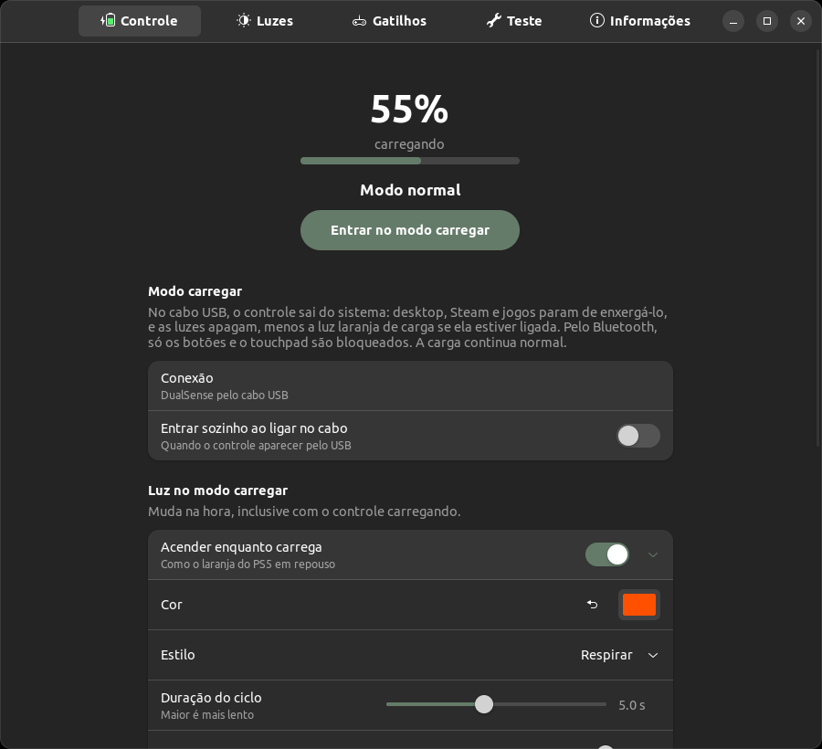
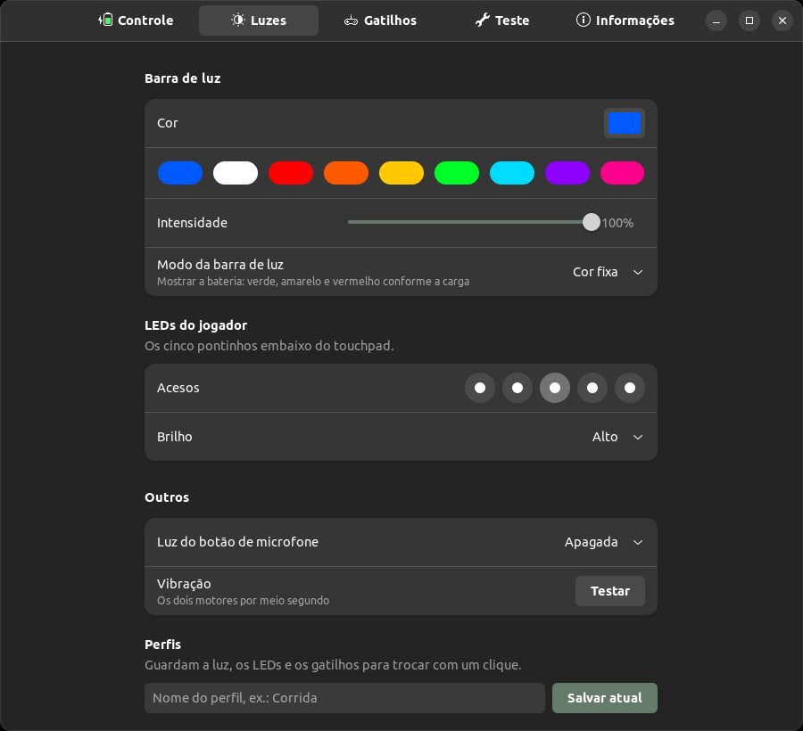
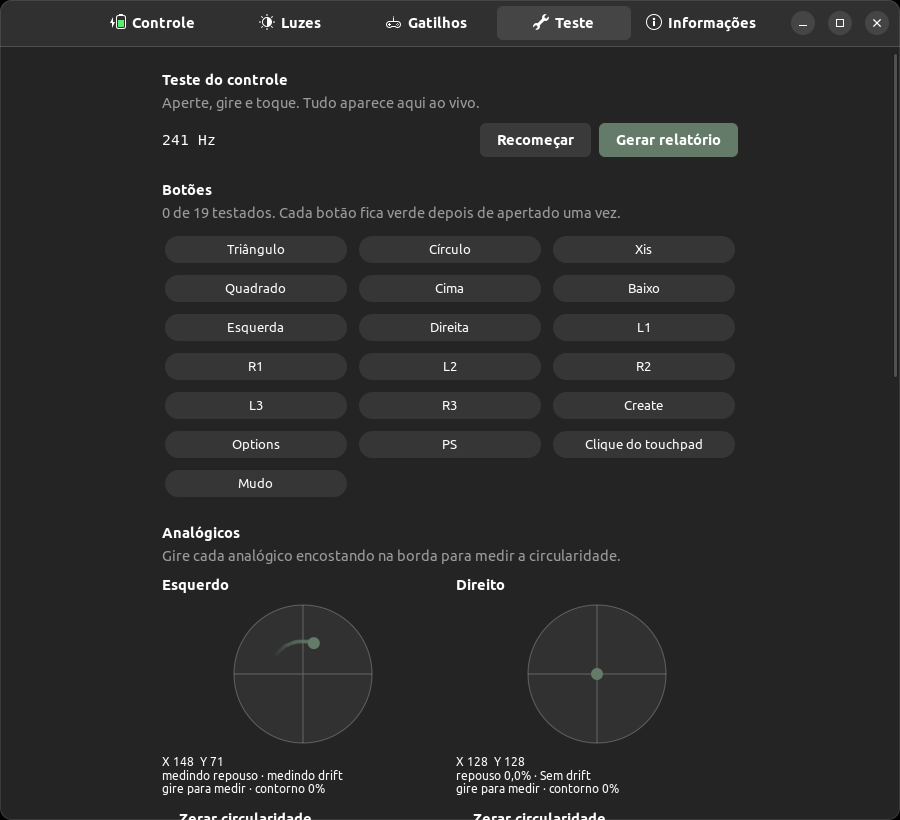

# Painel do DualSense

[](https://github.com/ayramesteodosio/dualsense-painel/actions/workflows/empacotar.yml)

App para o controle do PS5 no computador. Começou como um jeito de deixar o controle carregando no cabo
sem que a Steam e os jogos ficassem pegando ele, e foi ganhando o resto: luzes, gatilhos adaptativos,
teste de botões e as informações de fábrica.

No Linux a interface é GTK4 com libadwaita. No Windows e no macOS é Qt, com as mesmas funções.

  

## Funções

- Modo carregar: no cabo USB, o controle sai do sistema (desktop, Steam e jogos param de vê-lo), as luzes
  apagam e a barra pulsa em laranja até encher, como no PS5 em repouso. Com a janela fechada, o painel
  continua em segundo plano.
- Luz de carga: cor, estilo (respirar, fixa, piscar), duração do ciclo, intensidade e o que fazer quando
  encher.
- Barra de luz, LEDs do jogador e luz do microfone. A barra também pode mostrar a bateria pela cor.
- Gatilhos adaptativos: livre, resistência, gatilho de arma, arco, vibração, galope e máquina.
- Teste: os 19 botões, analógicos (zona morta, drift, circularidade), gatilhos, touchpad, giroscópio,
  acelerômetro, vibração por motor e áudio, com relatório em Markdown.
- Informações: modelo, cor de fábrica, placa (BDM), número de série, firmware, hardware e MAC.
- Perfis, histórico de bateria, aviso de bateria baixa, atalho PS + Options para o modo carregar e
  desligamento por inatividade no Bluetooth.

O [DualSense Studio](https://github.com/ayramesteodosio/dualsense-studio) usa este mesmo código com
outra interface.

## Baixar

Pegue o arquivo do seu sistema na [última versão](https://github.com/ayramesteodosio/dualsense-painel/releases/latest):

| Sistema | Arquivo | Como instalar |
|---|---|---|
| Windows 10 e 11 | `Painel-DualSense-windows.exe` | Abra e siga o instalador |
| macOS com chip Apple | `Painel-DualSense-macos-arm64.dmg` | Abra e arraste o app para Aplicativos |
| macOS com Intel | `Painel-DualSense-macos-intel.dmg` | Abra e arraste o app para Aplicativos |
| Ubuntu, Debian, Mint e derivados | `dualsense-painel_<versão>_all.deb` | Dois cliques, ou `sudo apt install ./dualsense-painel_*.deb` |

O app não tem assinatura digital, então o sistema avisa na primeira vez:

- Windows: em "O Windows protegeu o computador", clique em **Mais informações** e **Executar assim mesmo**.
- macOS: se o Mac não deixar abrir, vá em **Ajustes do Sistema > Privacidade e Segurança** e clique em
  **Abrir Mesmo Assim**.

Windows e macOS ainda não foram testados em máquinas reais, só com um controle simulado e com o pacote
rodando no Linux. Se algo não funcionar, abra uma issue.

## Rodar pelo código no Linux

```sh
git clone https://github.com/ayramesteodosio/dualsense-painel.git
cd dualsense-painel
./instalar.sh          # atalho no menu e regra do udev (pede a senha uma vez)
./dualsense-painel     # ou "Painel do DualSense" no menu
```

Precisa de Python 3.10+, GTK 4 e libadwaita, que já vêm no Ubuntu 22.04 com GNOME.

`dualsense-painel --carregar` e `dualsense-painel --normal` trocam o modo, inclusive com o app já aberto.

## Sistemas

| | Linux | Windows | macOS |
|---|---|---|---|
| Interface | GTK4 e libadwaita | Qt (PySide6) | Qt (PySide6) |
| Acesso ao controle | hidraw, sysfs e usbfs | hidapi | hidapi |
| Esconder dos jogos no modo carregar | sim | com o [HidHide](https://github.com/nefarius/HidHide) | sim (abertura exclusiva) |
| Fechar a janela no modo carregar | segue em segundo plano | vai para a bandeja | vai para a bandeja |

No Windows, sem o HidHide, o modo carregar só apaga as luzes e acompanha a bateria. Com ele, o painel pede
permissão de administrador ao esconder e mostrar o controle.

Para testar a versão Qt no Linux: `DS_PAINEL_UI=qt python3 -m dualsense_painel` (com PySide6 instalado).

## Limites do modo carregar

- Pelo Bluetooth só o desktop é bloqueado; Steam Input e SDL (HIDAPI) ainda leem o `hidraw`.
- Se o app morrer com o controle tomado (ex.: `kill -9`), o kernel não pega de volta sozinho. Abrir o app
  de novo devolve, e tirar e pôr o cabo também resolve.
- No Windows, se a Steam já estava com o controle aberto, ela só para de vê-lo depois de religar o cabo.

## Como funciona

- `protocol.py` monta os relatórios de saída (USB id 0x02, Bluetooth id 0x31 com CRC32), no layout do
  driver `hid-playstation` do kernel.
- `inputs.py` lê os relatórios de entrada: botões, analógicos, touchpad, giroscópio, acelerômetro e bateria.
- `device.py` acha o controle em `/sys/class/hidraw`. No modo carregar pelo USB, `UsbLink` usa
  `USBDEVFS_DISCONNECT_CLAIM` para tirar a interface HID do kernel e fala com o controle pelos endpoints de
  interrupção; `USBDEVFS_CONNECT` devolve. Pelo Bluetooth, cai para `EVIOCGRAB` nos `/dev/input/eventN`.
- `session.py` cuida da conexão, do modo carregar e da luz de carga, sem interface. Recebe um laço
  (`loop.py`) e um backend (`backends/linux.py` ou `backends/hidapi_backend.py`, com HidHide no Windows).
  O painel GTK, o painel Qt e o DualSense Studio usam o mesmo `Session`.
- `charge_light.py` calcula a cor da barra no modo carregar; `factory.py` lê série, cor de fábrica e placa
  pelo comando de teste 0x80/0x81; `history.py` guarda o histórico de bateria.
- `app.py` e `telas/` são a interface GTK; `qt/` é a interface Qt.
- Preferências em `~/.config/dualsense-painel/config.json` (`%APPDATA%` no Windows, `Application Support`
  no macOS), compartilhadas com o Studio. Só um app controla o controle por vez.

## Gerar o .exe e o .app

O fluxo `.github/workflows/empacotar.yml` gera os pacotes no GitHub Actions ao criar uma tag `v*` (e
publica em Releases) ou manualmente pela aba Actions. Localmente, em cada sistema:

```sh
pip install -r requirements.txt pyinstaller
python -m PyInstaller --noconfirm empacotar/dualsense-painel.spec
```

Os ícones saem de `dados/com.ayrames.DualSensePainel.svg` com `python3 ferramentas/gerar_icones.py`
(precisa de cairosvg e Pillow). O PySide6 fica fixo na 6.7.3: a 6.12 derruba o app no Python 3.10
(`none_dealloc`).

## Aviso

Projeto independente, sem relação com a Sony Interactive Entertainment. DualSense, PlayStation e
DualShock são marcas da Sony Interactive Entertainment Inc. e aparecem aqui só para indicar com qual
controle o app funciona.

## Testes

```sh
python3 -m unittest discover -s tests -t .
```
